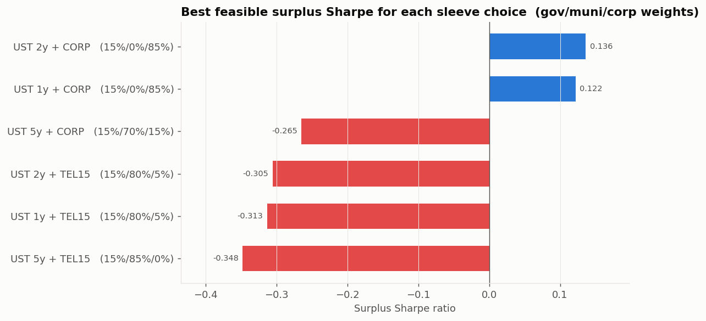
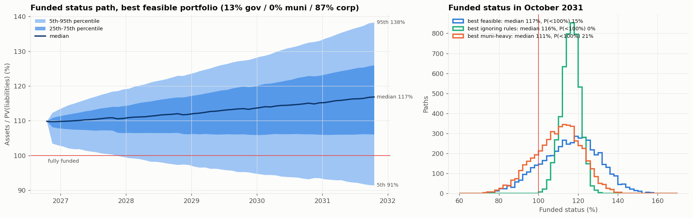

# UChicago Fixed Income Competition (Fall 2026): Monte Carlo Surplus Study

This folder holds a Monte Carlo model of a $100M city pension bond portfolio. It tests **every combination of government, municipal and corporate bonds** and ranks them by **surplus Sharpe ratio** against 30 years of pension liabilities. It also reports the **ending funded status** and **funded status volatility** for each mix. Corporate default and recovery rates come from **Moody's *Corporate Default and Recovery Rates, 1920-2008*** report, conditioned on today's (October 2026) macro regime.

---

## 1. Answer

**Best mix that follows the competition rules** (government ≤ 15%, duration 4-6 years, 1% grid):

| | Allocation |
|---|---|
| Government | **13%**: 2-year Treasuries |
| Municipal | **0%** |
| Corporate | **87%**: investment-grade corporates (ICE BofA C0A0 profile, A/Baa) |

| Metric | Value |
|---|---|
| Surplus Sharpe ratio | **0.141** |
| Starting funded status (Oct 2026) | 109.8% (assets $100M / liabilities $91.0M) |
| **Ending funded status, Oct 2031** | mean **116.0%**, median **116.8%** |
| Ending funded status range | 5th percentile **91.4%**, 95th percentile **138.3%** |
| **Funded status volatility** | **5.06% per year** (annualised volatility of monthly changes) |
| Spread of 2031 funded status across paths | 14.3 percentage points (1 standard deviation) |
| Chance of being underfunded in 2031 | 14.8% |
| Portfolio yield today | 5.76% |
| Expected return after default losses | 5.73% per year |
| Expected default loss | 0.035% per year (3.5 bp) |
| Modified duration | 5.99 years (at the 6-year limit) |

### What the results say

1. **The duration rule is the binding constraint.** The liabilities have an effective duration of **11.1 years**, but the rules cap assets at 6. Every extra year of duration hedges more of the liability, so the optimiser pushes duration to exactly 6.0.
2. **Munis get 0%.** The fund pays no tax, so it gets no benefit from the muni tax exemption. Munis yield about **3.81%** against **5.91%** on IG corporates at similar duration. The best mix with at least 50% munis (10% gov / 50% muni / 40% corp) has a surplus Sharpe of **−0.125**, a median 2031 funded status of 111%, and a 21% chance of being underfunded.
3. **Long telecom (C8R0) loses despite the highest yield (6.93%).** Its 13-year duration means it can only be held in small amounts while staying under 6 years. That forces the rest of the mix into low-yielding munis. Every mix built around it has a negative surplus Sharpe. The index also fell **8.7%** over the past year, about 2-3% worse than duration-matched Treasuries, which points to widening long-end telecom spreads.
4. **Short Treasuries are the best government sleeve.** 2-year notes add yield over T-bills, while 5-year notes use up the duration budget that corporates use better.
5. **The board's rules have a cost.** With no rules, the best mix is **60% 30-year Treasuries / 40% IG corporates** (duration 11.5, close to the liabilities' 11.1). It reaches a surplus Sharpe of **0.46**, funded status volatility of **2.1%**, and ~0% chance of underfunding. The 15% government cap and 6-year duration limit cut the Sharpe from 0.46 to 0.14 and raise funded status volatility from 2.1% to 5.1%.

### Predicted corporate default and recovery rates in the current regime

| Year | P(credit-stress year) | A | Baa | Ba | Spec-grade | Recovery (sr. unsecured) | Loss, IG corp sleeve | Loss, telecom sleeve |
|---|---|---|---|---|---|---|---|---|
| 2027 | 17% | 0.013% | 0.099% | 0.69% | 2.38% | 51.6% | 3.0 bp | 4.7 bp |
| 2028 | 25% | 0.017% | 0.123% | 0.77% | 2.71% | 50.5% | 3.8 bp | 6.0 bp |
| 2029 | 30% | 0.019% | 0.129% | 0.87% | 2.90% | 50.0% | 4.0 bp | 6.3 bp |
| 2030 | 35% | 0.020% | 0.146% | 0.94% | 3.11% | 49.5% | 4.6 bp | 7.3 bp |
| 2031 | 39% | 0.021% | 0.155% | 0.98% | 3.28% | 48.8% | 5.0 bp | 7.8 bp |

Interpretation: today's curve (10y − 1y = +0.60%) points to a **benign credit year in 2027** (only 18% chance of stress). Over five years the probability drifts back toward the long-run 44% stress frequency, so default rates rise and recoveries fall. "Loss" is the share of principal lost to defaults each year: default rate × (1 − recovery).

---

## 2. How to run

```bash
pip install numpy pandas scipy matplotlib openpyxl pypdf
python monte_carlo_allocation.py      # model only: prints results, writes CSVs (~3.5 min)
python visualize.py                   # runs the model, then draws all figures
```

The scripts read two files from the **parent folder** (they are not copied into the repo):

- `../fixed income data.xlsx`: Bloomberg pull, one year of daily data
- `../default_and_recovery_rates_02_09.pdf`: the Moody's 2009 default study

Outputs go to `output/`:

| File | Contents |
|---|---|
| `run_log.txt` | full printed output of the last run |
| `grid_coarse_5pct.csv` | every allocation × every sleeve choice, 5% steps (2,310 portfolios) |
| `grid_fine_1pct.csv` | the two best sleeve choices at 1% steps (2 × 5,151 portfolios) |
| `best_allocation.csv`, `headline_portfolios.csv` | best feasible, best with no rules, best muni-heavy |
| `credit_projection.csv` | predicted default and recovery rates by year |
| `figures/*.png` | charts (section 6) |

Results are reproducible: random seed 2026, 5,000 paths, 60 monthly steps. All portfolios share the same random draws, so differences between them come from the allocation, not from noise.

---

## 3. Data

### 3.1 Bloomberg market data (`fixed income data.xlsx`)

Daily, 15 Oct 2025 to 15 Oct 2026. Holiday and weekend fill rows are dropped, leaving 264 trading days.

| Ticker | What it is | Used for |
|---|---|---|
| GB12, GT2, GT3, GT5, GT7, GT10, GT20, GT30 Govt | 1/2/3/5/7/10/20/30-year Treasury yields | Pricing-date curve; covariance of curve moves; government sleeves; liability discounting |
| C0A0 Index | ICE BofA US Corporate Index (total return) | IG corporate sleeve: rate sensitivity and spread volatility |
| C8R0 Index | ICE BofA 15+ year telecom corporate index (total return) | Long telecom sleeve |
| U0A0 Index | ICE BofA US Municipal Index (total return) | Municipal sleeve |

Notes:
- The `.csv` export lost its date column (`#NAME?`) and the 1-year bill, so the model reads `fixed income data.xlsx`, which has both.
- The Treasury tenors are **1, 2, 3, 5, 7, 10, 20 and 30 years**.
- **Pricing date: 15 Oct 2026.** Curve: 1y 4.46%, 2y 4.74%, 3y 4.83%, 5y 4.88%, 7y 4.96%, 10y 5.06%, 20y 5.46%, 30y 5.41%. Yields rose about 85-130 bp over the year and the curve steepened sharply (figure 1).

### 3.2 Moody's data (`default_and_recovery_rates_02_09.pdf`)

The script reads these tables straight from the PDF, so nothing was typed in by hand:

| Exhibit | Content | Used for |
|---|---|---|
| **36** | Annual default rates by letter rating, 1920-2008 | Regime model; default-rate scenarios by rating |
| **26** | Annual average sr. unsecured bond recovery rates, 1982-2008 | Recovery model |
| **9** | Moody's own regression of recovery on spec-grade default rate | Check on our recovery fit |
| 12, 28, 29, 38-40 | High-yield spread vs default link; credit loss rates; cumulative default rates | Calibrating spread sensitivity; sanity checks |

---

## 4. Methodology, step by step

### Step 1: Model the credit cycle (Moody's Exhibit 36)

Default rates come in clusters: quiet years, then crises such as 1990-91, 2001-02 and 2008. To capture that, a **two-state hidden Markov model** (Baum-Welch EM, written in the script) is fit to the log of the annual speculative-grade default rate, **1970-2008**.

- **Why 1970 onwards:** fitting 1920-2008 made the model split "1942-1969" (an era with almost no defaults) from everything else. That is a structural break, not a credit cycle. The modern high-yield market starts around 1970.
- **Result: two regimes.**

| Annual default rate | Benign regime | Stress regime |
|---|---|---|
| A | 0.011% | 0.037% |
| Baa | 0.063% | 0.296% |
| Ba | 0.45% | 1.83% |
| B | 3.08% | 7.74% |
| Spec-grade | 1.71% | 5.71% |

- Years classified as stress: 1970, 1982-93, 1998-2003, 2008.
- Transition probabilities: benign → stress 13.3% per year; stress → benign 17.0% per year. Stress spells last about 6 years on average, and the long-run share of stress years is 44%.

### Step 2: Model recoveries (Moody's Exhibits 26 and 9)

Recoveries are lower when defaults are high. Regressing the yearly senior unsecured recovery rate on the spec-grade default rate (1982-2008) gives:

> **Recovery = 0.5877 − 3.026 × (spec-grade default rate)**, R² = 0.48, residual s.d. 8.2 pp

This reproduces Moody's own Exhibit 9 line (0.5877 − 3.0265x) exactly, which confirms the PDF was parsed correctly. In the simulation, each year's recovery equals this line plus random noise of the same size as the historical residuals, capped between 5% and 95%.

### Step 3: Place today in the cycle

The Bloomberg pull has no credit spreads, so the regime signal comes from the **Treasury curve slope**. The NY Fed / Estrella-Mishkin recession model is:

> P(recession within 12 months) = Φ(−0.5333 − 0.6330 × (10y − 3m))

The pull has no 3-month bill, so the **1-year bill is used in its place**. With 10y − 1y = **+0.60%**, the probability is **18.0%**. That is the probability that 2027 is a stress year. Years 2028-2031 then follow the transition probabilities from step 1, which give the default and recovery table in section 1.

### Step 4: Simulate the market (5,000 paths × 60 months)

Each path proceeds as follows:

1. **Credit regime by year:** draw the regime for each year (18% stress in year 1, then the Markov transitions).
2. **Default rates by year:** draw an actual historical year from Moody's 1970-2008, weighted toward years that match the drawn regime. Taking a whole historical year keeps the realistic co-movement between ratings (A, Baa, spec-grade and so on).
3. **Recovery by year:** the step 2 regression applied to that year's spec-grade default rate, plus noise.
4. **Treasury curve, monthly:** 8 tenors move together using the covariance of weekly yield changes over the past year, scaled to monthly. Annual volatility is about 60-74 bp per tenor.
   - In **stress years** the curve rallies and steepens as the Fed cuts: −125 bp per year at 1y, −70 bp at 10y, −50 bp at 30y.
   - These drifts are **demeaned across paths**. Stress years still rally, but the average rate path has zero drift, so the model carries **no net view on rates**. That keeps it from favouring long duration by assumption.
   - Yields are floored at 0.05%.
5. **Credit spreads, monthly:** spread = starting spread + β × (that year's spec-grade default rate − the benign average) + persistent noise.
   - β is 0.20 for IG corporates, 0.25 for long BBB telecom and 0.06 for munis. This is calibrated from Moody's Exhibit 12, where the HY spread moves roughly 1:1 with the spec-grade default rate, and IG spreads move about 0.2× as much as HY.
   - The noise volatility is the index's unexplained return volatility from the past year, divided by duration.
6. **Monthly return of each sleeve:**
   - Government: income (yield/12) − duration × Δyield + ½ × convexity × Δyield². Uses a constant-maturity par bond, rolled monthly.
   - Corporate and muni: income from (base Treasury yield + spread)/12, minus price change from rate and spread moves, minus that year's default loss/12.
   - Default loss = Σ over ratings of (rating weight × default rate × (1 − recovery)).
7. **Liabilities, monthly:** the present value of the remaining $0.5M monthly payments over **30 years** (360 payments), discounted on that path's Treasury curve.
   - At the pricing date: **PV = $91.04M**, effective duration **11.1 years**.

### Step 5: Run the fund

Each month assets earn the portfolio return, then pay $0.5M. The portfolio is rebalanced to the target weights every month:

> Assets(t+1) = Assets(t) × (1 + portfolio return) − $0.5M

### Step 6: Test every allocation

- **Weights:** every government / muni / corporate combination summing to 100%, in 5% steps (231 mixes), across **5 government sleeves** (1y, 2y, 5y, 10y, 30y) × **2 corporate sleeves** (IG C0A0, long telecom C8R0). That is 2,310 portfolios.
- **Refinement:** the two best sleeve choices are re-run at **1% steps** (5,151 mixes each).
- **Rule checks:** government ≤ 15%, and modified duration between 4 and 6 years at pricing-date yields. A 3-sleeve portfolio is always within the 6-position limit.

### Metric definitions

- **Monthly surplus return** (Leibowitz / Sharpe-Tint):
  r_S = r_Assets − (Liabilities / Assets) × r_Liabilities
  - r_Liabilities includes the benefit payment, so payments cancel out.
  - This is how much the surplus grew per dollar of assets.
- **Surplus Sharpe** = annualised mean of r_S ÷ annualised volatility of r_S, pooled across all paths and months.
  - No risk-free rate is subtracted, because the liability itself is the benchmark asset.
- **Funded status** = Assets / PV(Liabilities).
- **Funded status volatility** = standard deviation of monthly changes in funded status × √12. The cross-path spread of the 2031 funded status is also reported.
- **Expected return after defaults** = average across paths of the 5-year annualised asset return. It already includes the default losses.

---

## 5. Assumptions: what came from data and what was assumed

**Label key:**
- **Data:** taken directly from the Bloomberg or Moody's files.
- **Estimated:** fitted from those files.
- **Assumed:** a judgement call; the next column says how to replace it.

| Item | Value | Source | How to improve |
|---|---|---|---|
| Treasury curve today | see section 3.1 | **Data** (Bloomberg) | none |
| Curve volatility and correlation | weekly covariance, past year | **Estimated** | longer history |
| Default rates by rating | Moody's 1970-2008 | **Data** + HMM **estimated** | none |
| Recovery vs default rate | 0.588 − 3.03 × spec-grade default rate | **Estimated** (matches Moody's) | none |
| Current regime probability | 18% | **Estimated**: NY Fed probit, **1y used in place of 3m** | add 3m bill (GB3 Govt) |
| **IG corporate spread** | **0.90%** over avg(7y, 10y) Treasury → yield 5.91% | **Assumed**: the pull has index prices only, not yields | pull C0A0 yield-to-worst / OAS |
| **Telecom 15+ spread** | **1.50%** over avg(20y, 30y) → yield 6.93% | **Assumed** | pull C8R0 yield-to-worst / OAS |
| **Muni yield** | **0.76 ×** avg(7y, 10y) Treasury → 3.81% | **Assumed**: typical muni/Treasury ratio | pull U0A0 yield-to-worst |
| Modified durations | IG 6.6, telecom 13.0, muni 6.2 | **Assumed**: typical index values | pull the index modified duration fields |
| Rate sensitivity vs duration | IG 0.79, telecom 0.89, muni 0.89 | **Estimated**: regression beta ÷ modified duration (spreads partly offset rate moves) | none |
| Spread noise volatility | IG 1.6%, telecom 3.8%, muni 2.6% of return per year | **Estimated** | none |
| Rating mix, IG sleeve | 2% Aaa, 8% Aa, 42% A, 48% Baa | **Assumed**: typical ICE IG mix | index rating breakdown |
| Rating mix, telecom sleeve | 15% A, 85% Baa | **Assumed** | index rating breakdown |
| Spread sensitivity to defaults (β) | 0.20 / 0.25 / 0.06 | **Assumed**, guided by Moody's Exhibit 12 | none |
| Muni default rate / recovery | 0.01% benign, 0.05% stress / 60% | **Assumed**: Moody's muni study ballpark; **not in the provided PDF** | cite Moody's US Municipal Default study |
| Stress-year rate drift | −125 / −70 / −50 bp at 1y / 10y / 30y, demeaned | **Assumed** | none |
| Liabilities | 30 years × $6M level payments, Treasury discounting | **Assumed** reading of "30-year liabilities" | add COLA or a different discount rate |
| Rebalancing, costs | monthly to target weights, no transaction costs | **Assumed** | none |

**The spread and muni-yield assumptions matter most.** If the actual IG corporate yield on the pricing date is materially different from 5.91%, or the muni ratio is far from 0.76, the ranking could shift. To update, change the `spread` values and `MUNI_RATIO` in the `SLEEVES` block at the top of `monte_carlo_allocation.py` and re-run.

---

## 6. Figures

### 1. Market data

- Treasury yields rose about 1 percentage point and the curve steepened.
- The long telecom index lost 8.7%; IG corporates and munis were down only 1.6-1.8%.

### 2. Credit regimes and recoveries (Moody's)

- The shaded areas are the fitted stress regimes.
- The right panel shows recoveries falling as defaults rise; the line reproduces Moody's Exhibit 9.

### 3. Predicted default and recovery rates, 2027-2031


### 4. Surplus Sharpe for every allocation

- Uses the 2-year Treasury sleeve and IG corporate sleeve, at 1% steps.
- Blue means a positive surplus Sharpe, red negative.
- The outlined region is where both rules hold. The star marks the optimum, at the corner where the duration limit (6 years) meets the government cap.

### 5. Surplus risk vs return

- Every portfolio tested, across all sleeve choices.
- The rule-compliant set (blue) is a narrow band at roughly 3.5-4.3% surplus volatility. The best mix with no rules (green star) sits far up and to the left.

### 6. Best result for each sleeve choice


### 7. Funded status path and 2031 distribution


---

## 7. Limitations and next steps

1. **Replace the assumed yields with Bloomberg values.** Pull yield-to-worst and modified duration for C0A0, C8R0 and U0A0, and the 3-month bill. These are the biggest sources of model risk.
2. **Moody's data ends in 2008.** It covers the 2008 crisis but not 2009 (the default peak) or later cycles such as 2015-16 energy and 2020 COVID. A newer Moody's study would update the regime model.
3. **No rating migration.** Downgrade risk (for example BBB falling to high yield) enters only through spread widening tied to the regime.
4. **Index-level sleeves.** The competition allows up to six positions by rating and maturity. This study works at the asset-class level. A natural next step is to split the corporate sleeve into A vs Baa and short vs intermediate maturities, using the same engine.
5. **Liability discount rate.** Treasury discounting is market-consistent and conservative. A public plan using a 7% assumed return would show a much higher funded status, and a much lower liability duration.
6. **The competition's "event" is not built in yet.** The model deliberately takes no rate view and uses a probability-weighted credit view. A view on a specific event can be added by changing `STRESS_DRIFT`, the spread inputs, or the starting regime probability (`p_stress0`).

---

## 8. Files

| File | Purpose |
|---|---|
| `monte_carlo_allocation.py` | Whole model: data loading, Moody's parsing, regime and recovery fits, simulation, allocation grid |
| `visualize.py` | Runs the model and draws figures 1-7 |
| `output/` | CSV results, run log, figures |
