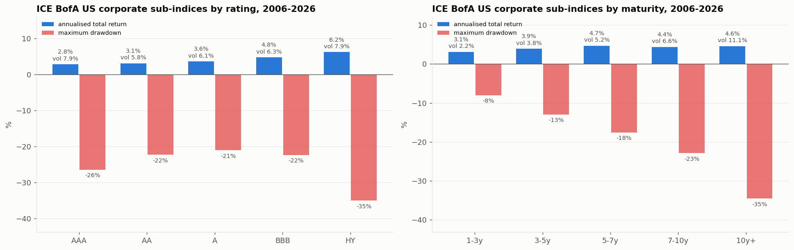
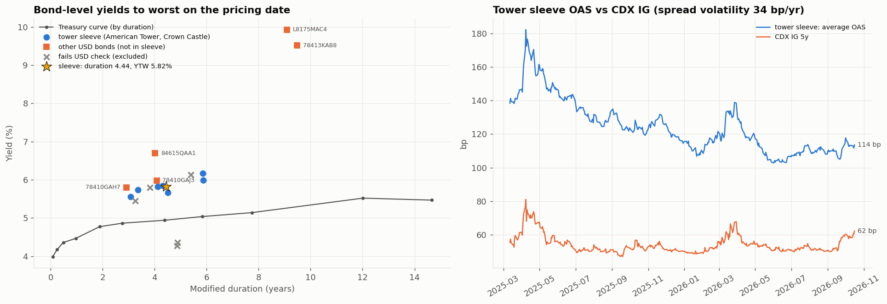
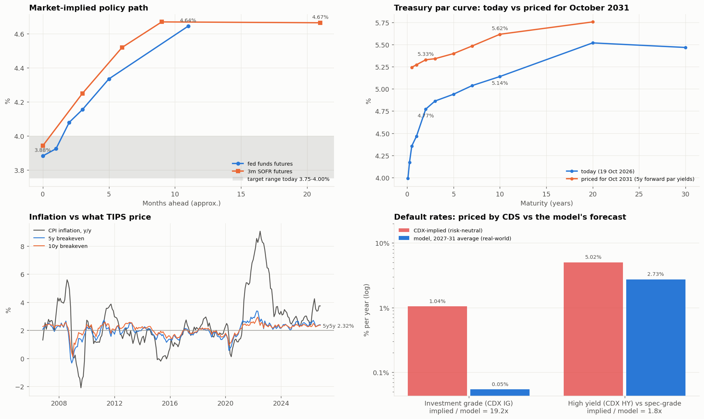

# UChicago Fixed Income Competition (Fall 2026): Monte Carlo Surplus Study

This repo holds a Monte Carlo model of a $100M city pension bond portfolio. It tests **every combination of government, municipal and corporate bonds** and ranks them by **surplus Sharpe ratio** against 30 years of pension liabilities.

For each mix it reports:
- the **ending funded status**;
- the **funded status volatility**;
- the **expected return after default losses**.

Corporate default and recovery rates come from Moody's *Corporate Default and Recovery Rates, 1920-2008*, adjusted for where the credit cycle stands on the pricing date, **19 October 2026**.

This version rebuilds the inputs on a much larger data pull:
- **20 years of daily Bloomberg data:** the Treasury curve from 1 month to 30 years with Bloomberg durations and convexities, ICE BofA rating and maturity sub-indices, TIPS, fed funds and SOFR futures, CDX, and macro series.
- **Bond-level data for 27 bonds:** OAS, prices, yield to worst and modified duration.

Several assumptions are now replaced by data. Section 7 lists every change.

```bash
pip install -r requirements.txt
python main.py          # about 3-4 minutes; writes output/*.csv, output/figures/*.png, prints a report
```

The scripts read four files from the **parent folder**. They are not stored in the repo:

| File | What it is |
|---|---|
| `../fixed income mega data.csv` | Bloomberg pull, daily, 19 Oct 2006 to 19 Oct 2026 |
| `../FILE_1065.pdf` | Bloomberg bond-level export: 17 bonds × (OAS, bid, mid, ask, YTW, modified duration), daily, Oct 2024 to Oct 2026 |
| `../ddd (1).pdf fff.pdf` | Bloomberg bond-level export: 10 bonds × OAS, same dates |
| `../default_and_recovery_rates_02_09.pdf` | Moody's default and recovery study, 1920-2008 |

**Contents**
1. Results
2. What the market is pricing (and the forecast for October 2031)
3. Data and how it was cleaned
4. Concepts used, with formulas
5. Methodology, step by step
6. Assumptions
7. What changed from the previous version
8. Tested and removed
9. Figures
10. Code layout
11. Limitations and next steps

---

## 1. Results

### Best allocation under the competition rules

The rules: government bonds at most 15%, and modified duration between 4 and 6 years.

| | Allocation |
|---|---|
| Government | **13%**: 2-year Treasuries |
| Municipal | **0%** |
| Corporate | **87%**: investment-grade corporates (ICE BofA C0A0 profile, A/Baa) |

| Metric | Value |
|---|---|
| Surplus Sharpe ratio | **0.100** |
| Starting funded status | 110.6% (assets $100M / liabilities $90.40M) |
| **Funded status in Oct 2031** | mean **116.7%**, median **117.2%**, 5th to 95th percentile **89.8% to 141.9%** |
| **Funded status volatility** | **6.0% per year** (annualised volatility of monthly changes) |
| Chance of being underfunded in 2031 | 15.1% |
| Yield today, and expected return after defaults | 5.83%; **5.80% per year** |
| Modified duration | 5.99 years (at the 6-year limit) |

### The bond-level alternative: a tower-sector corporate sleeve

The bond PDFs give actual market yields for 7 USD bonds of the two largest US tower companies:
- CUSIP issuer prefix 03027X, American Tower;
- CUSIP issuer prefix 22822V, Crown Castle.

As a sleeve they have:
- yield to worst **5.82%**;
- modified duration **4.44**;
- average OAS **113.5 bp**.

Section 5, step 8 shows how the sleeve is built. Running the same 1% grid with this sleeve as the corporate position (2y Treasury / muni / tower) gives:

| | C0A0 corporate sleeve (headline) | Tower corporate sleeve |
|---|---|---|
| Best rule-compliant mix | 13% 2y Treasury / 87% IG corporates | **100% tower corporates** |
| Surplus Sharpe | **0.100** | 0.088 |
| Duration | 5.99 | 4.44 |
| Median funded status 2031 | 117.2% | 117.5% |
| Funded status volatility | 6.0% | 6.4% |
| Chance underfunded 2031 | 15.1% | 18.3% |
| Expected default loss, 5y average | 3.3 bp a year (on the whole portfolio) | 6.8 bp a year |

- **Splitting the corporate weight hurts.** Moving the 87% corporate weight from C0A0 to the tower sleeve in 10% steps lowers the surplus Sharpe at every step: 0.100 → 0.098 → 0.095 → … → 0.059 at 100% tower (`output/corporate_split.csv`).
- **Why:** the tower bonds yield about the same (5.82% vs 5.99%), but their 4.4-year duration hedges less of the 10.8-year liabilities.
- **What it means:** the tower sleeve only belongs in the portfolio if the investment event (competition task 1) says something specific about tower credit that the market is not pricing. The model alone does not favour it.

### Expected return per year after expected default losses (competition task 3)

| Year | Portfolio yield | Expected default loss | **Expected return after defaults** | Simulated total return: mean (5th to 95th pct) |
|---|---|---|---|---|
| 2027 | 5.83% | 2.2 bp | **5.81%** | 5.65% (−3.4% to 15.5%) |
| 2028 | 5.83% | 2.8 bp | **5.80%** | 5.95% (−3.9% to 17.0%) |
| 2029 | 5.83% | 3.3 bp | **5.80%** | 6.09% (−4.2% to 17.3%) |
| 2030 | 5.83% | 3.7 bp | **5.79%** | 6.18% (−4.1% to 17.4%) |
| 2031 | 5.83% | 4.3 bp | **5.79%** | 6.22% (−4.6% to 18.2%) |

- **Expected return after defaults** = yield today − expected default loss. Expected default loss = Σ over ratings of (weight × default rate × (1 − recovery)).
- **Simulated total return** also includes price moves from rates and spreads.
  - It is below the yield in 2027, mainly because spreads start at today's level and widen on average as the expected default rate climbs from its benign starting point (spec-grade 2.1% in 2027 against the 1.7% benign mean). Wider spreads mean price losses.
  - It is above the yield later. The widening slows, while convexity (bond prices gain more when yields fall than they lose when yields rise by the same amount) and the zero floor on yields add a little every year.

### Projected portfolio value (after paying $6M per year)

| | Oct 2027 | Oct 2028 | Oct 2029 | Oct 2030 | **Oct 2031** |
|---|---|---|---|---|---|
| Mean | $99.5M | $99.2M | $98.9M | $98.6M | **$98.3M** |
| 95% band of outcomes | $89.1M to $110.9M | $85.3M to $114.7M | $83.4M to $117.3M | $82.0M to $117.6M | **$80.5M to $118.0M** |

- Including the $30M of benefits paid out, the fund generates $128.3M of value on average by 2031.
- The 95% band covers the range of outcomes across paths.
- The 95% confidence interval of the *mean* itself is only ±$0.27M, because the mean is estimated from 5,000 paths.

### What the results say

1. **The duration rule is the binding constraint.** The liabilities have a duration of **10.8 years**, but the rules cap assets at 6. Each extra year of asset duration hedges more of the liability, so the optimiser pushes duration to exactly 6.0.
   - The government sleeve sits at 13% of the 15% allowed. Its only job is to fill the duration budget: 87% × 6.6 + 13% × 1.89 = 5.99.
2. **Munis get 0%.** The fund pays no tax, so it gets nothing from the tax exemption.
   - Munis yield about **3.87%**, against **5.99%** on IG corporates at a similar duration.
   - The best mix with at least 50% munis (9% gov / 50% muni / 41% corp) has a surplus Sharpe of **−0.119**, a median 2031 funded status of 111%, and a 24% chance of underfunding.
3. **The rules have a cost.** With no rules, the best mix is **50% 30-year Treasuries / 50% IG corporates**, at duration 10.6, close to the liabilities' 10.8.
   - That mix has a surplus Sharpe of **0.40**, funded status volatility of **2.9%**, and almost no chance of underfunding (0.04%).
   - The 15% government cap and the 6-year duration limit cut the Sharpe from 0.40 to 0.10.
4. **Curve risk is mostly liability risk** (figure 9).
   - The chosen portfolio does best when long yields rise: bear steepener, Sharpe +0.28, mean funded status 123%.
   - It does worst when they fall: bull flattener, Sharpe −0.07, 24% chance of underfunding.
   - Falling yields raise the 10.8-year-duration liabilities more than the 6-year assets.
5. **The answer is unchanged from the previous version; the risk is higher.** The allocation is the same 13 / 0 / 87 as before. The Sharpe fell from 0.139 to 0.100, mainly because Treasury volatility is now estimated over five years (about 100 bp a year at 2-10y, including the 2022 rate shock) instead of one (about 65 bp). Section 5, step 3 shows the sensitivity.

### Predicted corporate default and recovery rates in the current regime

| Year | P(credit-stress year) | A | Baa | Ba | Spec-grade | Recovery (sr. unsecured) | Loss, IG corp sleeve | Loss, tower sleeve |
|---|---|---|---|---|---|---|---|---|
| 2027 | 11% | 0.013% | 0.087% | 0.60% | 2.14% | 52.3% | 2.5 bp | 4.6 bp |
| 2028 | 20% | 0.015% | 0.106% | 0.71% | 2.49% | 51.2% | 3.2 bp | 5.8 bp |
| 2029 | 27% | 0.017% | 0.125% | 0.82% | 2.79% | 50.4% | 3.8 bp | 7.0 bp |
| 2030 | 33% | 0.020% | 0.138% | 0.91% | 3.02% | 49.7% | 4.3 bp | 7.8 bp |
| 2031 | 37% | 0.021% | 0.155% | 0.99% | 3.23% | 48.9% | 4.9 bp | 8.9 bp |

- **2027 looks benign.** Today's curve (10y − 3m = +1.05 pp, one-month average) points to a benign credit year, with an 11.6% chance of stress. The macro dashboard agrees (section 2): jobless claims are at the 0.4th percentile of their 20-year history, the Sahm indicator is 0.03 pp, and CDX IG and HY spreads are at their medians.
- **After that, risk drifts up.** The probability drifts back toward the long-run 44% share of stress years, and defaults rise and recoveries fall as it does.
- **The tower sleeve's loss is higher** because it is all Baa. The IG index is assumed to be half A or better.

---

## 2. What the market is pricing, and the forecast for October 2031

The competition asks what the market prices instead of your event, and for a forecast of the Fed policy rate, the 2-year and 10-year yields and inflation in October 2031. The pull now allows all of these to be read from market prices (figure 12, `output/policy_path.csv`, `forecast_2031.csv`, `implied_defaults.csv`).

**Policy path (fed funds and SOFR futures).**
- Today: fed funds target 3.75-4.00%, effective rate about 3.88%.
- Fed funds futures price **4.65% for September 2027** (FF12).
- 3-month SOFR futures price 4.67% for the contract quarter about nine months out (SFR4), and the same 4.67% for the quarter about two years out (SFR8).
- So the market prices **roughly 75-80 bp of hikes over the next year, then a hold**. CPI inflation is 3.74%, at the 82nd percentile of its 20-year range.

**Forecast for October 2031**

| | Today | Market-implied for Oct 2031 | Model: mean (5th-95th pct) |
|---|---|---|---|
| Policy rate (proxy: 3m bill; market: 5y-forward 6-month rate) | 4.17% | 5.24% | 4.58% (0.05% to 8.59%) |
| 2-year Treasury | 4.77% | 5.33% | 4.91% (0.05% to 9.82%) |
| 10-year Treasury | 5.14% | 5.62% | 5.13% (0.93% to 9.15%) |
| CPI inflation | 3.74% (y/y) | 2.32% (5y5y breakeven) | not modelled |

- **Market-implied yields** are forward par yields bootstrapped from today's curve (section 4). They include a term premium, so they are not a pure forecast.
- **The model carries no rate view.** Its rate shocks average zero, so its mean is today's level except at the short end. There, the zero floor cuts off the paths with the deepest stress-year rallies and lifts the mean (3m by about 40 bp, 2y by about 15 bp; 10y unchanged).
- **How this shaped the portfolio.** The model's centred forecast, together with the liabilities' long duration, is why the portfolio sits at the top of the duration band. Buying shorter bonds to benefit from the hikes the market already prices would only pay if yields rose by more than the forwards imply.
- **Breakeven inflation:** 5y 2.40%, 10y 2.36%, 30y 2.26%. The market prices inflation falling from 3.7% back to about 2.3-2.4%.

**Default rates: CDS pricing vs the model** (credit triangle, section 4)

| | Spread | Recovery convention | Implied default rate | Model, 2027-31 average | Ratio |
|---|---|---|---|---|---|
| CDX IG 5y | 62.7 bp | 40% | 1.04% a year | 0.054% (IG) | **19×** |
| CDX HY 5y | 351 bp (from price 105.79) | 30% | 5.02% a year | 2.73% (spec-grade) | **1.8×** |

- **What the gap is.** CDS prices are risk-neutral: they include a premium for bearing default risk, so they overstate actual defaults, most of all in investment grade (the "credit spread puzzle").
- **Use in the write-up.** This table is a ready-made "what the market is pricing" line for competition task 1.

**Macro dashboard** (latest value and its percentile in its own 2006-2026 monthly history, `output/macro_dashboard.csv`)

| Series | Latest | Percentile | Reads as |
|---|---|---|---|
| Unemployment rate | 4.2% | 27th | benign |
| Sahm indicator (3m avg unemployment − prior 12m low) | 0.03 pp | 59th | far below the 0.5 pp recession trigger |
| Initial jobless claims | 199k | 0.4th | very benign |
| ISM manufacturing PMI | 54.5 | 63rd | expansion |
| Real GDP growth (q/q annualised) | 2.2% | 38th | trend |
| CPI inflation | 3.74% | 82nd | elevated |
| Bloomberg US financial conditions | 0.88 | 85th | loose |
| VIX | 18.4 | 58th | normal |
| 10y − 3m Treasury | 0.97 pp | 40th | positive slope |
| CDX IG / HY spread | 62.7 / 351 bp | 44th / 50th | normal |

---

## 3. Data and how it was cleaned

### 3.1 Bloomberg mega pull (`fixed income mega data.csv`)

Daily from 19 Oct 2006 to 19 Oct 2026: 7,306 calendar days, of which 5,266 trading days are kept.

| Group | Tickers | Fields | Used for |
|---|---|---|---|
| Treasury curve | USGG1M, 3M, 6M, 12M, 2YR, 3YR, 5YR, 7YR, 10YR, 20YR, 30YR | yield; modified duration and convexity (`#mod_dur`, `#cnvx`) for 3M-30Y | Pricing-date curve, covariance, liabilities, durations, stress-drift calibration, forwards |
| ICE BofA indices | C0A0 (US Corp), U0A0 (US Muni), C8R0 (15+y Telecom), H0A0 (US High Yield) | total-return level | Empirical rate betas and residual volatility (C0A0, U0A0); 20-year risk table |
| Corporate by rating | C0A1 (AAA), C0A2 (AA), C0A3 (A), C0A4 (BBB) | level | 20-year risk table, figure 10 |
| Corporate by maturity | C1A0 (1-3y), C2A0 (3-5y), C3A0 (5-7y), C4A0 (7-10y), C9A0 (10y+) | level | 20-year risk table, figure 10 |
| TIPS | USGGT05Y, T10Y, T30Y | real yield, duration, convexity | Breakeven inflation |
| Fed policy | FDTR (target, upper bound); FF1-FF4, FF6, FF12 (fed funds futures); SFR1-4, SFR8 (3m SOFR futures) | price, implied rate | Market-implied policy path |
| Credit | CDX IG and CDX HY 5y generic | IG spread (bp); HY price | Market-implied default rates; IG/HY spread beta |
| Macro | USURTOT, INJCJC, NAPMPMI, IP CHNG, GDP CQOQ, BFCIUS, VIX, CPI YOY | level | Macro dashboard |

**Pricing-date curve (19 Oct 2026):**

| Tenor | 1m | 3m | 6m | 1y | 2y | 3y | 5y | 7y | 10y | 20y | 30y |
|---|---|---|---|---|---|---|---|---|---|---|---|
| Yield | 3.99% | 4.17% | 4.36% | 4.47% | 4.77% | 4.86% | 4.94% | 5.04% | 5.14% | 5.52% | 5.47% |
| Mod. duration | 0.08* | 0.25 | 0.49 | 0.97* | 1.89 | 2.76 | 4.38 | 5.84 | 7.74 | 12.02 | 14.66 |

\* Not available from Bloomberg on the pricing date, so computed with the par-bond formula. Where both exist, the formula matches Bloomberg to within 0.005 years (e.g. 2y: 1.886 vs 1.886), which validates it.

**Data problems found and how they are handled** (all in `model/data.py`):

| Problem | Evidence | Handling |
|---|---|---|
| The sheet has two header rows, and the ticker is written only above the first of its fields | Row 1 is the ticker, row 2 the field | Each column inherits the ticker to its left |
| **20y and 30y yields in the first block are date-formatted** (e.g. `1/5/1900` = 5) and have lost their decimals | Non-numeric cells | Yields come from the clean second block of `px_last` columns. Elsewhere it matches the first block exactly (differences ≤ 0.004 pp, only on the last day, from snapshot timing). |
| **The USGG12M block (yield, duration, convexity) is printed one row late**, and its field row is blank | Its yields equal the clean 12M column shifted by exactly one row on 90% of days, and differ from the unshifted column on 56%. Its 19 Oct value sits in an undated row below the table. | The block is shifted up one row |
| Weekend and holiday rows repeat the previous value | 7,306 calendar days | Rows where no Treasury yield or index level changed are dropped |
| Series start at different dates: 12M in 2008, 7y in 2009, CDX in 2011, SOFR futures in 2018, 20y in 2020 | First valid dates | The 5-year covariance window (Oct 2021 to Oct 2026) has every tenor; the stress-drift calibration uses only tenors observed in both recessions |
| The ICE indices are levels only, with no yield, OAS or duration | n/a | The C0A0 and U0A0 yields and durations remain **ASSUMED** (section 6); the bond-level data supplies actual yields for the tower sleeve |

### 3.2 Bond-level PDFs (`FILE_1065.pdf`, `ddd (1).pdf fff.pdf`)

**Format.** Each PDF is a spreadsheet printed *down then across*:
- the first block of pages holds the date column and the first few data columns for all 731 days (Excel serial dates 45584-46314, i.e. 19 Oct 2024 to 19 Oct 2026, weekends included);
- each later block continues the columns for the same 731 rows;
- the first page of every block repeats the field names.

**Parsing** (`model/bonds.py`):
- the column blocks are stacked side by side;
- the ticker and field header sequence is checked to repeat exactly;
- each block is checked to have the same 731 rows.

**Validation:**
- FILE_1065 has 17 bonds × 6 fields = 102 data columns; ddd has 10 bonds × OAS.
- Two bonds appear in both files (03027XCH1, 22822VBE0). Their OAS agree **exactly on all 497 shared days**, which confirms the parsing is right.

**Pricing-date snapshot** (`output/bond_universe.csv`):

| Group | Bonds | Price | YTW | Mod. dur. | OAS | In the tower sleeve? |
|---|---|---|---|---|---|---|
| American Tower (03027X) | BS8, CH1, CN8 | 85.7-98.0 | 5.55-5.99% | 3.1-5.9 | 87-126 bp | **Yes** |
| Crown Castle (22822V) | AR2, AW1, AY7, BE0 | 85.5-97.8 | 5.73-6.17% | 3.4-5.9 | 105-144 bp | **Yes** |
| American Tower / Crown Castle, OAS only | 03027X BW9, BZ2, CD0, CF5, CR9, CU2; 22822V BC4, BG5 | n/a | n/a | n/a | 107-144 bp | No: no yield or duration in the pull. Their OAS confirm the sleeve's spread level. |
| 78410G | AH7, AJ3 | 96.6-97.3 | 5.80-5.98% | 2.9-4.1 | 114-130 bp | No: a different issuer, rating not in the pull, and only 3 months of history |
| Other USD issuers | 84615QAA1; 78413KAB8, L8175MAC4 | 94.6; 63-64 | 6.70%; 9.5-9.9% | 4.0; 9.1-9.5 | 193; 464-489 bp | No: issuer and rating not in the pull. The last two trade at distressed-looking prices. |
| XS (Eurobond ISINs) | 5 bonds | 84.9-99.3 | 4.28-6.13% | 3.3-5.4 | 78-254 bp | No: **fail the USD check** below |

**USD check (competition rule 4: US dollar bonds only).**
- **The test.** For a USD bond, YTW − OAS is the USD benchmark rate the spread is measured over, which must be at least the lowest point of the US curve (3.99%).
- **USD bonds pass.** Every USD bond above gives 4.66-5.04%.
- **XS bonds fail.** All five give **3.50-3.59%**. Two of them (XS2227906208, XS3082807135) even yield *less* than the duration-matched Treasury (4.28-4.35% vs 4.97%) while showing a positive OAS.
- **Conclusion.** These five are priced off a non-USD curve and are excluded. Confirm the currency on Bloomberg `DES`.

**OAS date.** Bloomberg leaves OAS blank on 19 Oct in FILE_1065, so each bond uses its last OAS on or before the pricing date (16 Oct). The ddd export carries the 16 Oct value forward to 19 Oct.

**Yield to worst vs yield to maturity.** The competition answer sheet asks for yield to maturity. All 7 sleeve bonds trade **below par** (85.5-98.0). For a bond below par, every par call date gives a *higher* yield than holding to maturity, so the worst case is maturity. **YTW = YTM for the whole sleeve.**

### 3.3 Moody's (`default_and_recovery_rates_02_09.pdf`)

The tables are parsed straight from the PDF:

| Exhibit | Content | Used for |
|---|---|---|
| 36 | Annual default rates by rating, 1920-2008 | Regime model; default scenarios |
| 26 | Senior unsecured recoveries, 1982-2008 | Recovery model |
| 9 | Moody's recovery-vs-default regression | Validation |
| 12 | High-yield spread vs default rate (text: spreads near 1,000 bp at spec-grade default peaks of 10-12%) | Cross-check of spread sensitivity |

---

## 4. Concepts used, with formulas

**Yield to maturity (YTM)** is the single discount rate that sets the present value of a bond's cash flows equal to its price. With semi-annual coupons c, face 100 and n periods: P = Σ (c/2)/(1+y/2)^i + 100/(1+y/2)^n.

**Yield to worst (YTW)** is the lowest of the YTM and the yields to each call date. It differs from YTM only for callable bonds trading above par.

**Par yield.** The coupon at which a bond prices at par. Bloomberg's generic Treasury yields (USGG) are par-style yields for each maturity.

**Discount factors and bootstrapping.** From par yields c(T), the discount factor P(T) for each semi-annual date solves 1 = (c/2) Σ_{i<n} P(t_i) + (1 + c/2) P(t_n), taken one maturity at a time (`market.discount_curve`).

**Forward par yield.** The yield on an L-year bond starting T years from now that today's curve implies: f = 2 [P(T) − P(T+L)] / Σ_{i} P(T + i/2). With T = 5 this is "what the market prices for October 2031" (`market.forward_par`).

**Modified duration (D)** is the percentage price change per unit change in yield: D = −(1/P) dP/dy. For a par bond, D = [1 − (1+y/2)^(−2n)] / y.

**Convexity (Cx)** is the second-order term: Cx = (1/P) d²P/dy². Bloomberg's `#cnvx` field is convexity/100, so the model multiplies it by 100.

**Price change approximation.** ΔP/P ≈ −D Δy + ½ Cx Δy². For index sleeves, convexity is approximated as 1.1 × D², hence the 0.55 D² Δy² term in the code.

**One-period return of a bond sleeve.** Return ≈ income (yield/12) − D × Δyield + ½ Cx × Δyield² − default loss/12.

**Spread over Treasuries.** The sleeve's yield minus the yield of the Treasury with the same duration. For the bond-level data the Treasury yield is interpolated *in duration space* using Bloomberg's Treasury durations.

**Option-adjusted spread (OAS).** The constant spread over the benchmark curve, after valuing any embedded call, that reprices the bond. Bloomberg's USD OAS is measured over a curve slightly below Treasuries, so OAS is about 25 bp above the plain spread over Treasuries for these bonds.

**Expected default loss** = default rate × (1 − recovery), weighted across ratings. This is the "share of principal lost to defaults each year" the answer sheet asks for.

**Credit triangle.** A CDS spread s compensates for default intensity λ times loss given default: s ≈ λ (1 − R), so λ ≈ s / (1 − R).

**CDX HY price to spread.**
- CDX HY trades as a price with a fixed 500 bp coupon: price = 100 + (coupon − s) × RPV01.
- RPV01 = Σ_{quarters} 0.25 e^(−(r+λ)t) is the risky annuity, with λ = s/(1 − 0.30) and r = the 5y Treasury yield.
- s is solved by iteration (`market.cdx_spreads`).

**Risk-neutral vs real-world default rates.**
- CDS-implied rates are risk-neutral: they price in a premium for bearing default risk. Real-world rates are what actually happens, as in the Moody's data.
- The ratio is large for IG (19× here) and small for HY (1.8×). This is the well-documented "credit spread puzzle".

**Duration times spread (DTS).** Empirically, spread changes are proportional to the spread level, so a bond with twice the spread has about twice the spread volatility (Ben Dor, Dynkin et al., 2007). The model uses it to scale spread sensitivity from the IG index to the tower sleeve.
- **Data check:** the tower sleeve's annual OAS volatility relative to its level is 0.28, against 0.33 for CDX IG over the same two years. That is close, so the proportionality holds roughly.

**Breakeven inflation** = nominal Treasury yield − TIPS real yield of the same maturity. The 5y5y forward breakeven ≈ 2 × BE10 − BE5: the average inflation priced for years 6 to 10.

**Funded status (FS)** = assets / present value of liabilities.

**Surplus return** (monthly) = asset return − (L/A) × liability return. It is the change in surplus (A − L) per dollar of assets. Benefit payments cancel out of it, because a payment lowers A and L equally.

**Surplus Sharpe ratio** = annualised mean ÷ annualised volatility of the surplus return, pooled over all paths and months. No risk-free rate is subtracted, because the liability is the benchmark: a perfectly hedged portfolio scores zero.

**Funded status volatility** = standard deviation of monthly FS changes × √12.

**Monte Carlo simulation.** The model draws thousands of random paths for the economy and evaluates every portfolio on the *same* paths ("common random numbers"). Differences between portfolios then reflect the portfolios, not sampling luck.

**Cholesky decomposition.** A covariance matrix Σ factors as L Lᵀ. Multiplying independent standard normals z by L gives shocks Lz with covariance Σ. This is how correlated curve moves are generated.

**AR(1) noise.** e_t = 0.9 e_{t−1} + ε_t gives spread shocks persistence: a widening tends to last rather than reverse next month.

**Hidden Markov model (HMM).** The economy is in one of two unobserved states, benign or stress. Each year it stays or switches with fixed probabilities (the transition matrix P), and the observed default rate is drawn from a normal distribution specific to the state.
- **Baum-Welch** (expectation-maximisation) estimates the state means, variances and P.
- The forward-backward pass gives the probability of each state in each year.

**Probit recession model (NY Fed / Estrella-Mishkin).** P(recession within 12 months) = Φ(−0.5333 − 0.6330 × S), where S is the 10-year minus 3-month Treasury spread in percentage points (monthly average) and Φ is the standard normal CDF. At S = 0 the probability is 30%; an inverted curve (S < 0) pushes it higher.

**Sahm indicator** = the 3-month average unemployment rate minus its lowest 3-month average over the previous 12 months. A reading of 0.5 pp or more has marked the start of every US recession since 1970.

**NBER business-cycle peak.** The month the National Bureau of Economic Research dates as the start of a recession. The sample has two: December 2007 and February 2020.

---

## 5. Methodology, step by step

**Step 1: Load and clean the data** (section 3).

**Step 2: The pricing-date curve and Treasury analytics.**
- The curve is the 11 Bloomberg generic yields on 19 Oct 2026.
- The 2-year Treasury sleeve's reported duration (1.886) is Bloomberg's `#mod_dur`.
- Inside the simulation, each month's duration and convexity are recomputed with the par-bond formula on that path's yield, because the sleeve is rolled into a new 2-year note every month.

**Step 3: Treasury curve dynamics.**
- **Covariance.**
  - Weekly changes in all 11 yields over the last 5 years (19 Oct 2021 to 19 Oct 2026, 261 weeks) give an 11×11 covariance matrix, scaled to monthly by × 52/12.
  - Five years matches the simulation horizon and covers a full hiking-and-holding cycle.
  - Annualised volatility: 2y 103 bp, 10y 96 bp, 30y 84 bp.
- **Shocks.** Each month every path draws 11 standard normals and multiplies them by the Cholesky factor, so the 11 yields move with the historical correlations.
- **Stress-year drift, calibrated on data.**
  - In a credit-stress year the curve rallies and steepens.
  - The size is the average 12-month yield change after the two NBER peaks in the sample (Dec 2007 → Dec 2008 and Feb 2020 → Feb 2021): **−220 bp at 3m, −153 bp at 2y, −105 bp at 5y, −78 bp at 10y, −65 bp at 30y** (figure 1, bottom right).
  - Tenors missing in 2007 (1y, 7y, 20y) are interpolated.
  - These compare with the previous assumption of −125 / −70 / −50 bp at 1y / 10y / 30y.
- **Demeaning.**
  - The drift is demeaned across paths each month. Paths in a stress year rally, paths in a benign year drift up by the offsetting amount, and the average path has no net rate move.
  - So the model has no rate view, but rates still co-move with the credit cycle. That co-movement is what makes Treasuries hedge corporate credit.
- **Floor.** Yields are floored at 0.05%. Because of the floor, the mean short rate in 2031 sits slightly above today's.
- **Sensitivity to the window:** see "Robustness" at the end of this section.

**Step 4: The credit cycle (HMM on Moody's defaults).**
- **Fit.** A two-state Gaussian HMM is fit by Baum-Welch to the log spec-grade default rate, **1970-2008**.
  - Fitting from 1920 just separates the near-zero-default era of 1942-69 from everything else. That is a structural break, not a cycle.
- **Regimes found.**
  - Benign: spec-grade defaults 1.7% a year, Baa 0.06%.
  - Stress: spec-grade 5.7%, Baa 0.30%.
- **Transitions.** Benign → stress 13.3% a year; stress → benign 17.0% a year. The long-run share of stress years is 13.3 / (13.3 + 17.0) = 44%.
- **Years labelled stress:** 1970, 1982-93, 1998-2003 and 2008.
- **Default rates by rating** in each regime are the regime-probability-weighted averages of Exhibit 36.

**Step 5: Recovery.**
- **Fit.** An ordinary least squares fit of Exhibit 26 recoveries on the same year's spec-grade default rate: **recovery = 0.5877 − 3.026 × spec-grade default rate** (R² 0.48), with residual noise of 8.2 pp.
- **Validation.** This reproduces Moody's own Exhibit 9 line exactly, which confirms the PDF parsing.

**Step 6: Where we are now.**
- **Probit.** The NY Fed probit on the one-month average 10y − 3m spread (1.05 pp) gives **P(stress in 2027) = 11.6%**.
  - The pull now has the 3-month bill, so the old 1-year stand-in is gone. That stand-in gave 18%.
- **Cross-check.** The macro dashboard (section 2) confirms benign conditions.
- **Later years** follow the HMM transition matrix.

**Step 7: The credit path of each simulation** (5,000 paths × 60 months, seed 2026).
- Each year, draw the regime: the first year with probability 11.6%, later years by the Markov transitions.
- Then draw one *historical Moody's year* from that regime, weighted by its regime probability. That year supplies the default rates for every rating at once, so their co-movement is kept.
- Recovery then comes from step 5, plus noise.

**Step 8: The sleeves.**

| Sleeve | Yield today | Duration | Rate beta | Spreads | Default loss |
|---|---|---|---|---|---|
| 2y Treasury | 4.77% (data) | 1.886 (Bloomberg) | 1 | none | none |
| IG corporate, C0A0 | avg(7y, 10y) + 0.90% = 5.99% (**ASSUMED** spread) | 6.6 (**ASSUMED**) | 0.93 (estimated) | +0.20 × (spec-grade default rate − benign mean) + AR(1) noise | rating mix 2/8/42/48% Aaa/Aa/A/Baa (**ASSUMED**) × Moody's rates × (1 − recovery) |
| Municipal, U0A0 | 0.76 × avg(7y, 10y) = 3.87% (**ASSUMED** ratio) | 6.2 (**ASSUMED**) | 0.74 (estimated) | +0.06 × same + AR(1) noise | 0.01% / 0.05% a year in benign / stress, 60% recovery (**ASSUMED**) |
| Tower corporate | **5.82%: average YTW of the 7 bonds (data)** | **4.44: average modified duration (data)** | 1.00 (estimated) | +0.197 × same (DTS-scaled) + AR(1) noise, volatility **34 bp a year** from OAS history | 100% Baa (**ASSUMED** rating) |

- **Rate beta (index sleeves).**
  - The rate beta is the index's *empirical* rate sensitivity divided by its modified duration.
  - The empirical sensitivity is the slope of log index returns on changes in the matched Treasury yield, averaged over weekly and monthly regressions in the same 5-year window.
  - A beta below 1 means spreads partly offset rate moves (they tend to widen when Treasuries rally).
  - The residual volatility of that regression sets the size of the spread noise.
- **Tower sleeve construction** (`bonds.tower_sleeve`).
  1. **Universe.** USD bonds of the two tower issuers that have YTW and duration on the pricing date and pass the USD check: 7 bonds, equally weighted.
  2. **Yield and duration.** The averages of the bonds' own pricing-date values.
  3. **Base rate.** The generic Treasury closest in duration: the 5-year (duration 4.38 vs the sleeve's 4.44). The spread over it is 88 bp; the average spread over each bond's duration-matched Treasury is 87 bp.
  4. **Spread volatility.** The annualised standard deviation of monthly changes in the sleeve's average OAS, over the bonds' common history (Mar 2025 to Oct 2026).
  5. **Rate beta.** For each bond, regress weekly log price changes on the change in its duration-matched Treasury yield, and divide the slope by the bond's modified duration. The average is 1.01 (range 0.96-1.07), capped at 1. Tower bond prices move one-for-one with Treasuries.
  6. **Spread sensitivity to defaults.** The IG assumption (0.20) × the ratio of the sleeve's spread over Treasuries to the IG index's (88 / 90 bp) = 0.197. This is the DTS scaling.
- **Monthly return**, for every sleeve, is income − D × (rate beta × Δbase + Δspread) + convexity − default loss / 12.

**Step 9: Liabilities.**
- The liabilities are $0.5M a month for 30 years.
- Their present value is computed on each path's curve every month. Par yields are converted to continuously compounded zero rates with z = 2 ln(1 + y/2) and interpolated linearly across the 11 tenors.
- At the start: **$90.40M, modified duration 10.8**.

**Step 10: The fund.**
- Each month it earns the portfolio return, pays $0.5M, and rebalances to its target weights.
- Assets are floored at zero.

**Step 11: Metrics** (section 4): surplus return and Sharpe; funded status mean, median, 5th/95th percentiles and volatility; chance of underfunding in 2031; simulated annual total returns; expected return after defaults.

**Step 12: Grid and rules.**
- **Main grid.** Every 2y Treasury / muni / C0A0 mix in 1% steps: 5,151 portfolios.
- **Tower grid.** The same with the tower sleeve as the corporate position: 5,151 more.
- **Benchmark.** The same grid with 30-year Treasuries in 5% steps, ignoring the rules.
- **Rule check.** Each mix is checked against the 15% government cap and the 4-6 year duration rule. Duration is the weighted average of the sleeves' modified durations at pricing-date yields, as rule 2 requires.
- **Split check.** For the winner, the corporate weight is also split between C0A0 and the tower sleeve in 10% steps.

**Step 13: Curve views.** The chosen portfolio is re-run under four curve views (bull/bear steepener/flattener). Each view adds its total yield change by 2031, spread linearly over 60 months, on top of the same random draws.

**Step 14: Market pricing** (section 2):
- futures-implied rates (100 − price);
- forwards bootstrapped from the pricing-date curve;
- breakevens from TIPS;
- CDX-implied default rates from the credit triangle;
- the IG/HY spread beta from weekly CDX changes, 2011-2026.

**Step 15: Index history.** For each ICE index, 2006-2026:
- annualised return and volatility from weekly data;
- maximum drawdown;
- drawdowns in the 2008 crisis, the 2020 Covid shock and the 2022 rate shock;
- correlation with 10-year yield changes.

These are in `output/index_history.csv` and figure 10. BBB returned 4.8% a year against 2.8-3.6% for AAA-A, with similar volatility (6.3%) and drawdowns (−22%). That supports the A/Baa tilt of the corporate sleeve.

**Robustness: the covariance window.** The model was re-run with 1-, 3- and 5-year windows for the curve covariance and the index rate betas:

| Window | 2y / 10y volatility | Best rule-compliant mix (2y / muni / IG) | Surplus Sharpe | Funded status vol. | Median FS 2031 | P(underfunded) |
|---|---|---|---|---|---|---|
| 1 year | 65 / 65 bp | 13% / 0% / 87% | 0.146 | 4.9% | 117.8% | 13.4% |
| 3 years | 91 / 88 bp | 13% / 0% / 87% | 0.103 | 5.7% | 117.4% | 15.8% |
| **5 years (used)** | 103 / 96 bp | **13% / 0% / 87%** | **0.100** | 6.0% | 117.2% | 15.1% |

The allocation does not move. Only the risk level does, which is why the Sharpe fell from the previous version's 0.139.

---

## 6. Assumptions

**Label key:**
- **Data:** taken directly from the Bloomberg files or the Moody's study.
- **Estimated:** fitted from those files.
- **ASSUMED:** a judgement call. These are all in `model/config.py`; to update one, change it there and re-run.

| Item | Value | Source |
|---|---|---|
| Treasury curve, 1m-30y, and durations | Bloomberg, 19 Oct 2026 | **Data** |
| Treasury volatility and correlation | Weekly changes, Oct 2021 to Oct 2026 | **Estimated** |
| Stress-year rate drift | −220 / −153 / −78 / −65 bp at 3m / 2y / 10y / 30y, demeaned | **Estimated** (2 NBER recessions) |
| Default rates by rating, regimes | Moody's 1970-2008 | **Data** / **Estimated** |
| Recovery vs default | 0.588 − 3.03 × spec-grade default rate | **Estimated** (matches Moody's) |
| Current regime | 11.6% stress probability (10y − 3m probit) | **Estimated** |
| IG and muni rate betas | 0.93 and 0.74 | **Estimated** |
| Tower sleeve yield, duration, spread, spread volatility, rate beta | 5.82%, 4.44, 88 bp, 34 bp/yr, 1.00 | **Data** / **Estimated** |
| Tower sleeve rating | Baa (both issuers are rated in the Baa/BBB range; ratings are not in the pull) | **ASSUMED** |
| Tower spread sensitivity to defaults | 0.197 = IG assumption × DTS ratio | **Estimated** from an ASSUMED base |
| IG corporate spread | 0.90% over avg(7y, 10y) → 5.99% yield | **ASSUMED**: the pull has index levels only |
| Muni yield | 0.76 × avg(7y, 10y) → 3.87% | **ASSUMED** |
| Index modified durations | IG 6.6, muni 6.2 | **ASSUMED**: typical ICE index values |
| IG rating mix | 2% Aaa / 8% Aa / 42% A / 48% Baa | **ASSUMED** |
| IG spread sensitivity to defaults | 0.20 (CDX cross-check: 0.159 IG/HY beta × Moody's ~0.91 HY-spread-to-default ratio = 0.145; cash bonds typically move more than CDS) | **ASSUMED**, cross-checked |
| Muni spread sensitivity, default and recovery | 0.06; 0.01% / 0.05%; 60% | **ASSUMED**: not in the provided data |
| CDX recovery conventions | IG 40%, HY 30% | Market convention |
| Liabilities | 30 years × $6M level payments, Treasury discounting | **ASSUMED** reading of "30-year liabilities" |

**The IG spread and the muni ratio still matter most.** To replace them, pull from Bloomberg the yield to worst, OAS, modified duration and rating breakdown for C0A0 and U0A0 on the pricing date (fields `yield(yield_type=YTW)`, `spread(spread_type=OAS)`, `duration(duration_type=MODIFIED)` on the index tickers, the same BQL calls used for the bond PDFs). Then put them in `SLEEVES` in `model/config.py`.

---

## 7. What changed from the previous version

| | Before | Now |
|---|---|---|
| Pricing date | 15 Oct 2026 | **19 Oct 2026** |
| Data history | 1 year, daily | **20 years**, daily |
| Treasury tenors | 8 (1y-30y) | **11 (1m-30y)** |
| Treasury durations | Computed | **Bloomberg** `#mod_dur` / `#cnvx` |
| Covariance window | 1 year | **5 years** (all 11 tenors available) |
| Recession probit | 10y − **1y** (proxy), pricing day | 10y − **3m**, one-month average (NY Fed method) |
| P(stress) 2027 | 18% | **11.6%** |
| Stress-year rate drift | ASSUMED −125 / −70 / −50 bp | **Estimated** from the 2008 and 2020 recessions |
| Index rate betas (IG, muni) | 0.79, 0.89 (1 year) | 0.93, 0.74 (5 years) |
| Corporate sleeves | C0A0 profile only (ASSUMED yield) | Plus a **tower sleeve with actual market yields** from bond-level data |
| Market pricing | None | Policy path, 2031 forwards, breakevens, CDX-implied defaults, macro dashboard |
| Index history | One year of C0A0 / C8R0 / U0A0 | 20 years, 13 ICE indices by rating and maturity |
| Best allocation | 13% 2y / 0% muni / 87% IG | **Unchanged** |
| Surplus Sharpe | 0.139 | 0.100 (higher estimated rate volatility) |
| Funded status 2031, median | 116.7% | 117.2% |
| Funded status volatility | 5.0% | 6.0% |
| Expected return after defaults | 5.73% | 5.80% |

---

## 8. Tested and removed (didn't change the answer)

These were run in earlier versions, never affected the result, and were removed to keep the model lean. The numbers come from those runs.

| Tested | Result | Why removed |
|---|---|---|
| **15+ yr telecom (C8R0) as the corporate sleeve** | Best rule-compliant Sharpe **−0.31**. Its 13-year duration forces the rest of the mix into munis. | Never chosen. C8R0 is kept in the 20-year risk table: the highest volatility (12.7%) of all indices. |
| **1y / 5y / 10y / 30y Treasury as the government sleeve** | 1y: Sharpe 0.12; 5y: −0.27 (forces munis to hit duration); 10y/30y infeasible within the rules | 2y equal or better in every case |
| **Multi-maturity government sleeve**: up to 3 Treasury maturities at once, 5,676 mixes × 5 curve views | Best sleeve in every view within noise of plain 2y Treasuries | No meaningful curve bet; replaced by the curve-view stress test |
| **5%-then-1% two-pass grid** | Same optimum | One 1% pass |

---

## 9. Figures (`output/figures/`)

| # | Figure |
|---|---|
| 01 | Market data: curve today vs 1 and 5 years ago, 20-year yield history, ICE indices, stress-drift calibration  |
| 02 | Moody's default history with fitted regimes; recovery vs default  |
| 03 | Predicted stress probability, default rates by rating, and recovery, 2027-31  |
| 04 | Surplus Sharpe for every allocation, with the rule-compliant region outlined  |
| 05 | Surplus risk vs return: C0A0 grid, tower grid, and the no-rules benchmark  |
| 06 | Funded status fan chart and 2031 distribution  |
| 07 | Expected return per year after expected default losses  |
| 08 | Projected portfolio value: mean with 50% and 95% bands  |
| 09 | Curve views and the chosen portfolio's 2031 funded status under each  |
| 10 | ICE corporate sub-indices by rating and maturity, 2006-2026  |
| 11 | Bond-level yields vs duration on the pricing date; tower OAS vs CDX IG  |
| 12 | What the market prices: policy path, 2031 forward curve, breakevens, CDX-implied vs model defaults  |

---

## 10. Code layout

```
main.py               run everything: inputs, simulation, grids, curve views, market pricing, CSVs, figures, report
model/config.py       every input and assumption (paths, fund, rules, sleeves, curve views)
model/data.py         Bloomberg mega-CSV loader (with the data fixes), market statistics, Moody's PDF parser
model/bonds.py        bond-level PDF parser, pricing-date bond table, USD check, tower sleeve
model/market.py       policy path, bootstrapped forwards, breakevens, CDX spreads and implied defaults,
                      macro dashboard, ICE index history
model/credit.py       HMM credit regimes, recovery fit, regime probability, default projection
model/simulation.py   Monte Carlo of curve, regimes, spreads, defaults, liabilities
model/portfolio.py    allocation grid, batched portfolio evaluation, yearly returns, value bands
model/plots.py        figures 01-12
output/               CSVs (model_inputs, allocation_grid, allocation_grid_tower, headline_portfolios,
                      corporate_split, credit_projection, expected_return_by_year, portfolio_value,
                      curve_views, bond_universe, policy_path, forecast_2031, implied_defaults,
                      macro_dashboard, index_history), run_log.txt, figures/
```

`output/model_inputs.csv` lists every number the simulation used and where it came from.

---

## 11. Limitations and next steps

1. **The ICE index yields, spreads and durations are still assumed** (section 6). The bond-level pull shows how to get them: run the same BQL fields on C0A0 and U0A0. A **taxable muni index** would suit a tax-free fund far better than tax-exempt munis.
2. **Stress-year drift rests on two recessions** and is applied to every HMM stress year. Those years include milder credit-stress years, such as 1986-89, that did not see recession-sized rallies, so the drift likely overstates rate moves in mild stress years. Because it is demeaned, it adds credit-linked rate volatility rather than a directional view.
3. **Rate volatility drives the Sharpe level.** The five-year window includes the 2022 shock, so 2-10y volatility is about 100 bp a year against about 65 bp over the last year alone. The allocation is driven by the duration rule and is not sensitive to this; the Sharpe level is.
4. **Moody's data ends in 2008.** A newer study would add the 2009 and 2020 default peaks.
5. **No rating migration**, apart from regime-linked spread widening.
6. **No issuer concentration risk.** The tower sleeve holds only two issuers. The model applies average Baa default rates and does not capture the jump risk of one issuer defaulting.
7. **Selection noise.** Neighbouring allocations differ by about 0.003 in Sharpe, which is within Monte Carlo error. Treat the answer as "maximum allowed duration, mostly A/Baa corporates" rather than an exact 13%.
8. **Sub-sleeves.** The competition allows six positions by rating and maturity. The 20-year sub-index history (figure 10) is the starting point. Splitting the corporate sleeve by rating and maturity needs each sub-index's yield and duration, which are not in this pull.
