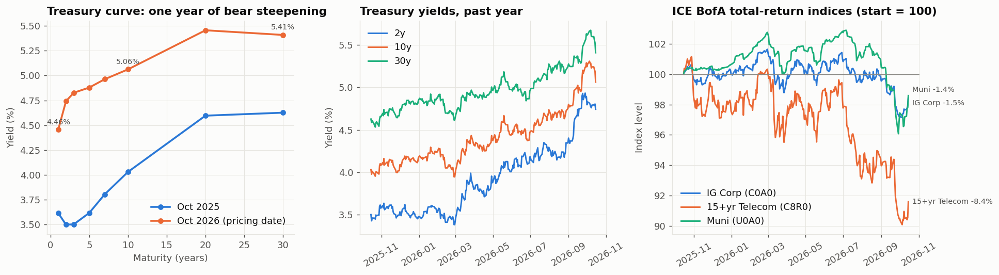
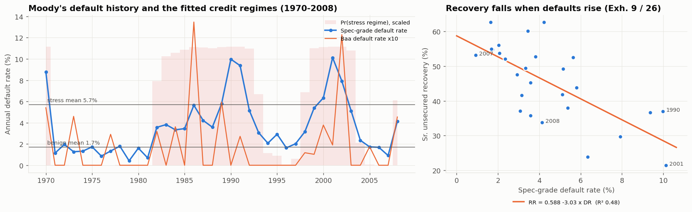
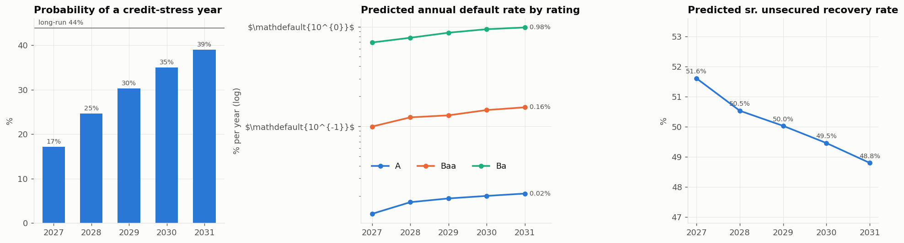
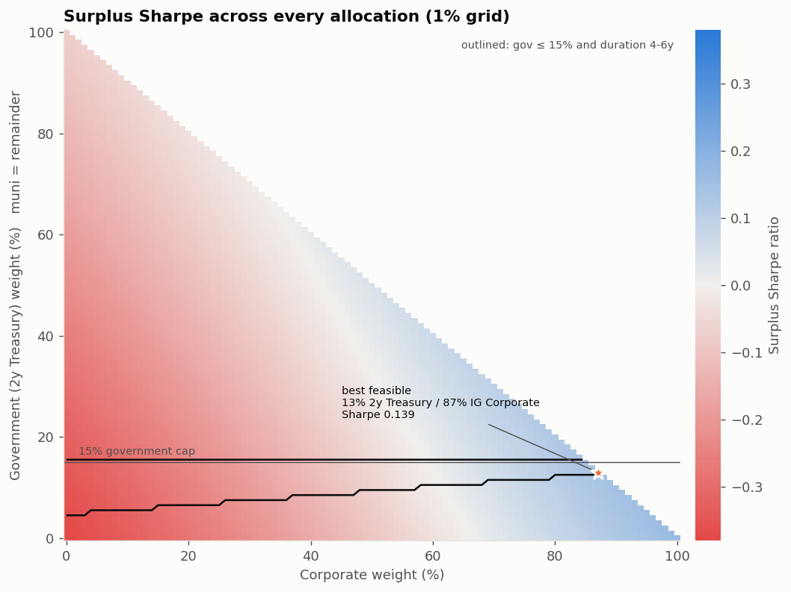
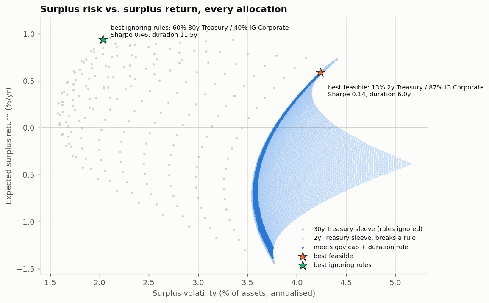
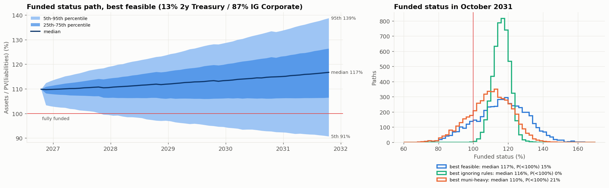
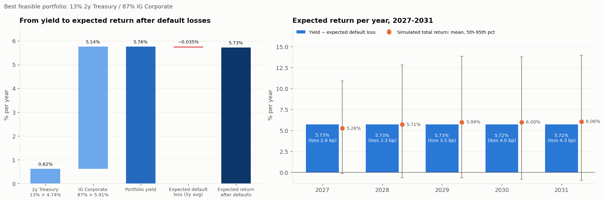
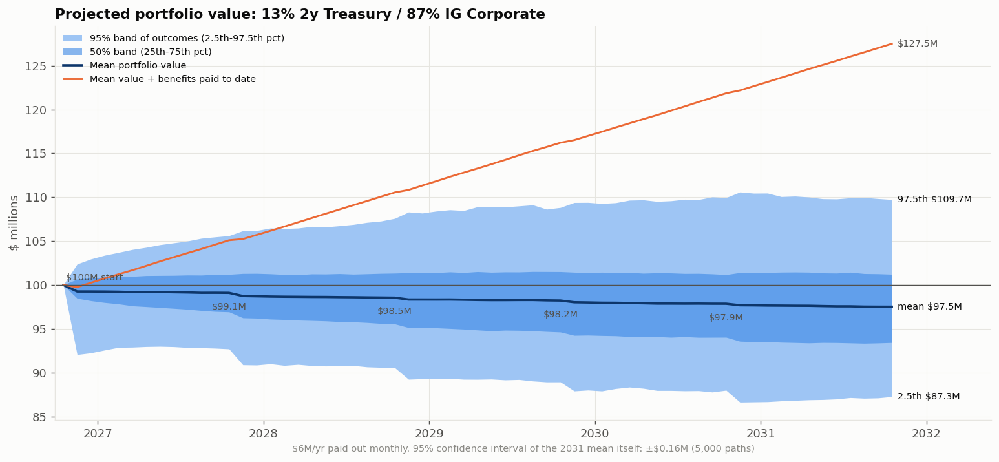
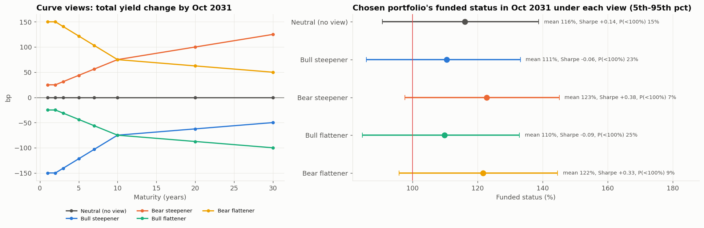

# UChicago Fixed Income Competition (Fall 2026): Monte Carlo Surplus Study

This repo holds a Monte Carlo model of a $100M city pension bond portfolio. It tests **every combination of government, municipal and corporate bonds** and ranks them by **surplus Sharpe ratio** against 30 years of pension liabilities. For each mix it also reports the **ending funded status**, the **funded status volatility**, and the **expected return after default losses**. Corporate default and recovery rates come from Moody's *Corporate Default and Recovery Rates, 1920-2008*, adjusted for where the credit cycle stands today (October 2026).

```bash
pip install -r requirements.txt
python main.py          # about 3 minutes; writes output/*.csv, output/figures/*.png, prints a report
```

The scripts read two files from the **parent folder**, which are not stored in the repo:
- `../fixed income data.xlsx`: Bloomberg pull
- `../default_and_recovery_rates_02_09.pdf`: Moody's study

---

## 1. Results

### Best allocation under the competition rules

The rules: government bonds at most 15%, and modified duration between 4 and 6 years.

| | Allocation |
|---|---|
| Government | **13%**: 2-year Treasuries |
| Municipal | **0%** |
| Corporate | **87%**: investment-grade corporates (ICE BofA C0A0 profile, A/Baa) |

| Metric | Value |
|---|---|
| Surplus Sharpe ratio | **0.139** |
| Starting funded status | 109.8% (assets $100M / liabilities $91.0M) |
| **Funded status in Oct 2031** | mean **116.0%**, median **116.7%**, 5th to 95th percentile **90.7% to 138.8%** |
| **Funded status volatility** | **5.0% per year** (annualised volatility of monthly changes) |
| Chance of being underfunded in 2031 | 14.9% |
| Yield today, and expected return after defaults | 5.76%; **5.73% per year** |
| Modified duration | 5.99 years (at the 6-year limit) |

### Expected return per year after expected default losses (competition task 3)

| Year | Portfolio yield | Expected default loss | **Expected return after defaults** | Simulated total return: mean (5th to 95th pct) |
|---|---|---|---|---|
| 2027 | 5.76% | 2.6 bp | **5.73%** | 5.26% (−0.1% to 10.9%) |
| 2028 | 5.76% | 3.3 bp | **5.73%** | 5.71% (−0.6% to 12.8%) |
| 2029 | 5.76% | 3.5 bp | **5.73%** | 5.99% (−0.7% to 13.9%) |
| 2030 | 5.76% | 4.0 bp | **5.72%** | 6.00% (−0.8% to 13.8%) |
| 2031 | 5.76% | 4.3 bp | **5.72%** | 6.06% (−1.0% to 14.0%) |

- **Expected return after defaults** = yield today − (default rate × (1 − recovery)).
- **Simulated total return** also includes price moves from rates and spreads. It is below yield in 2027 and above it later, because the chance of a stress year, when rates rally, rises over time (see section 3, step 4).

### Projected portfolio value (after paying $6M per year)

| | Oct 2027 | Oct 2028 | Oct 2029 | Oct 2030 | **Oct 2031** |
|---|---|---|---|---|---|
| Mean | $99.1M | $98.6M | $98.2M | $97.9M | **$97.5M** |
| 95% band of outcomes | $92.7M to $105.6M | $90.6M to $107.6M | $88.9M to $108.8M | $88.0M to $110.0M | **$87.3M to $109.7M** |

- Including the $30M of benefits paid out, the fund generates $127.5M of value on average by 2031.
- The 95% band covers the range of outcomes across paths.
- The 95% confidence interval of the *mean* itself is only ±$0.16M, because it is estimated from 5,000 paths.

### What the results say

1. **The duration rule is the binding constraint.** The liabilities have a duration of **11.1 years**, but the rules cap assets at 6. Each extra year of asset duration hedges more of the liability, so the optimiser pushes duration to exactly 6.0.
2. **Munis get 0%.** The fund pays no tax, so it gets nothing from the tax exemption.
   - Munis yield about **3.81%**, against **5.91%** on IG corporates at a similar duration.
   - The best mix with at least 50% munis (9% gov / 50% muni / 41% corp) has a surplus Sharpe of **−0.124**, a median 2031 funded status of 110%, and a 21% chance of underfunding.
3. **The rules have a cost.** With no rules, the best mix is **60% 30-year Treasuries / 40% IG corporates**, at duration 11.5, close to the liabilities' 11.1.
   - That mix has a surplus Sharpe of **0.46**, funded status volatility of **2.1%**, and almost no chance of underfunding.
   - The 15% government cap and 6-year duration limit cut the Sharpe from 0.46 to 0.14.
4. **Curve risk is mostly liability risk** (figure 9). The chosen portfolio does best when long yields rise (bear steepener: Sharpe +0.38, mean funded status 123%) and worst when they fall (bull flattener: Sharpe −0.09, 25% chance of underfunding). Falling yields raise the 11-year-duration liabilities more than the 6-year assets.
   - Re-optimising the government sleeve for each curve view changed nothing meaningful (section 4). The best sleeve was always about 11-15% in 1-5 year Treasuries, used to fill the duration budget. A curve bet inside a 15% sleeve doesn't move the answer.

### Predicted corporate default and recovery rates in the current regime

| Year | P(credit-stress year) | A | Baa | Ba | Spec-grade | Recovery (sr. unsecured) | Loss, IG corp sleeve |
|---|---|---|---|---|---|---|---|
| 2027 | 17% | 0.013% | 0.099% | 0.69% | 2.38% | 51.6% | 3.0 bp |
| 2028 | 25% | 0.017% | 0.123% | 0.77% | 2.71% | 50.5% | 3.8 bp |
| 2029 | 30% | 0.019% | 0.129% | 0.87% | 2.90% | 50.0% | 4.0 bp |
| 2030 | 35% | 0.020% | 0.146% | 0.94% | 3.11% | 49.5% | 4.6 bp |
| 2031 | 39% | 0.021% | 0.155% | 0.98% | 3.28% | 48.8% | 5.0 bp |

- Today's curve (10y − 1y = +0.60%) points to a **benign credit year in 2027**, with an 18% chance of stress.
- After that, the probability drifts back toward the long-run 44% share of stress years. Defaults rise and recoveries fall as it does.

---

## 2. Data

### Bloomberg (`fixed income data.xlsx`)
- **Coverage:** daily, 15 Oct 2025 to 15 Oct 2026, with holiday and weekend fill rows dropped. The CSV export lost its dates and the 1-year bill, so the model reads the `.xlsx`.
- **Treasury yields:** GB12, GT2, GT3, GT5, GT7, GT10, GT20 and GT30. That is 1/2/3/5/7/10/20/30-year maturities.
- **Pricing-date curve (15 Oct 2026):** 1y 4.46%, 2y 4.74%, 5y 4.88%, 10y 5.06%, 20y 5.46%, 30y 5.41%.
- **ICE BofA total-return indices:** C0A0 (US Corporate), C8R0 (15+ year telecom), U0A0 (US Municipal). These are price levels only; no yields or durations.

### Moody's (`default_and_recovery_rates_02_09.pdf`)
The tables are parsed straight from the PDF:

| Exhibit | Content | Used for |
|---|---|---|
| 36 | Annual default rates by rating, 1920-2008 | Regime model; default scenarios |
| 26 | Senior unsecured recoveries, 1982-2008 | Recovery model |
| 9 | Moody's recovery-vs-default regression | Validation |
| 12 | High-yield spread vs default link | Spread sensitivity to defaults |

---

## 3. Methodology

1. **Credit cycle.**
   - A two-state hidden Markov model (Baum-Welch) is fit to the log spec-grade default rate, **1970-2008**.
   - Fitting from 1920 just separates the near-zero-default era of 1942-69 from everything else. That is a structural break, not a cycle.
   - The result is a benign regime (spec-grade defaults 1.7%, Baa 0.06%) and a stress regime (5.7% and 0.30%).
   - Transitions: benign → stress 13.3% a year; stress → benign 17.0% a year.
   - Years labelled stress: 1970, 1982-93, 1998-2003 and 2008.
2. **Recovery.**
   - Fit: **recovery = 0.5877 − 3.026 × spec-grade default rate** (R² 0.48), with residual noise of 8.2 pp.
   - This reproduces Moody's own Exhibit 9 line exactly, which confirms the PDF parsing.
3. **Where we are now.**
   - The NY Fed / Estrella-Mishkin model gives P(recession in 12 months) = Φ(−0.5333 − 0.6330 × (10y − 3m)).
   - The 1-year bill stands in for the 3-month, which isn't in the pull.
   - Result: 18% for 2027. Later years follow the Markov transitions.
4. **Simulation** (5,000 paths × 60 months, seed 2026):
   - Each year: draw a regime, then a historical Moody's year from that regime. The year supplies default rates for every rating at once, keeping their co-movement. Recovery then comes from step 2.
   - Treasury curve: shocks use the past year's weekly covariance.
     - In stress years the curve rallies and steepens (−125 / −70 / −50 bp a year at 1y / 10y / 30y).
     - That drift is *demeaned across paths*, so the model has no net rate view.
   - Spreads: starting spread + 0.20 × (spec-grade default rate − its benign average) for IG, plus persistent noise. Munis use 0.06.
   - Sleeve returns: income − duration × yield change + convexity − default loss.
     - Treasuries are constant-maturity par bonds.
     - Index sleeves use their empirical rate sensitivity relative to modified duration (IG 0.79, muni 0.89). This captures spreads partly offsetting rate moves.
   - Liabilities: present value of the remaining $0.5M monthly payments over 30 years, on each path's curve. At the start: $91.04M, duration 11.1.
5. **The fund.** Each month it earns the portfolio return, pays $0.5M, and rebalances to target weights.
6. **Grid.**
   - Every government (2y Treasury) / muni / IG corporate mix in **1% steps**: 5,151 portfolios.
   - The same grid with 30-year Treasuries in 5% steps, ignoring the rules, as the benchmark.
   - Each mix is checked against the government cap and the 4-6 year duration rule.
7. **Curve views.** The chosen portfolio is re-run under four curve views (bull/bear steepener/flattener), adding their yield changes on top of the same random draws.

**Metrics**
- **Surplus return** (monthly) = asset return − (liabilities/assets) × liability return. Benefit payments cancel out.
- **Surplus Sharpe** = annualised mean ÷ annualised volatility of the surplus return, pooled over all paths and months. No risk-free rate is subtracted, because the liability is the benchmark.
- **Funded status** = assets / PV(liabilities).
- **Funded status volatility** = standard deviation of monthly changes × √12.

---

## 4. Tested and removed (didn't change the answer)

These were run in earlier versions, never affected the result, and were removed to keep the model lean. The numbers come from those runs.

| Tested | Result | Why removed |
|---|---|---|
| **15+ yr telecom (C8R0) as the corporate sleeve** | Best rule-compliant Sharpe **−0.31**. Its 13-year duration forces the rest of the mix into munis. The index fell 8.7% last year, 2-3% worse than duration-matched Treasuries. | Never chosen |
| **1y / 5y / 10y / 30y Treasury as the government sleeve** | 1y: Sharpe 0.12; 5y: −0.27 (forces munis to hit duration); 10y/30y infeasible within the rules | 2y equal or better in every case |
| **Multi-maturity government sleeve**: up to 3 Treasury maturities at once, 5,676 mixes × 5 curve views | Best sleeve in every view: neutral 13% 2y + 1% 10y; bull steepener 13% 2y; bear steepener 11% 2y + 4% 5y; bull flattener 4% 1y + 8% 2y; bear flattener 3% 1y + 11% 2y + 1% 30y. All within noise of plain 2y Treasuries. | No meaningful curve bet; replaced by the curve-view stress test |
| **5%-then-1% two-pass grid** | Same optimum | One 1% pass |

---

## 5. Assumptions

**Label key:**
- **Data:** taken directly from the Bloomberg or Moody's files.
- **Estimated:** fitted from those files.
- **ASSUMED:** a judgement call. These are all in `model/config.py`; to update one, change it there and re-run.

| Item | Value | Source |
|---|---|---|
| Treasury curve, volatility, correlation | Bloomberg, past year | **Data** / **Estimated** |
| Default rates by rating, regimes | Moody's 1970-2008 | **Data** / **Estimated** |
| Recovery vs default | 0.588 − 3.03 × spec-grade default rate | **Estimated** (matches Moody's) |
| Current regime | 18% stress probability (1y used in place of 3m) | **Estimated** |
| IG corporate spread | 0.90% over avg(7y, 10y) → 5.91% yield | **ASSUMED**: the pull has index prices only |
| Muni yield | 0.76 × avg(7y, 10y) Treasury → 3.81% | **ASSUMED** |
| Modified durations | IG 6.6, muni 6.2 | **ASSUMED**: typical ICE index values |
| IG rating mix | 2% Aaa / 8% Aa / 42% A / 48% Baa | **ASSUMED** |
| Spread sensitivity to defaults | IG 0.20, muni 0.06 | **ASSUMED**, guided by Moody's Exh. 12 |
| Muni default / recovery | 0.01% benign, 0.05% stress / 60% | **ASSUMED**: not in the provided PDF |
| Stress-year rate drift | −125 / −70 / −50 bp at 1y / 10y / 30y, demeaned | **ASSUMED** |
| Liabilities | 30 years × $6M level payments, Treasury discounting | **ASSUMED** reading of "30-year liabilities" |

**The IG spread and the muni ratio matter most.** To replace them with real data, pull from Bloomberg the yield to worst, OAS, modified duration and rating breakdown for C0A0 and U0A0 on the pricing date. Then put them in `SLEEVES` in `model/config.py`.

---

## 6. Figures (`output/figures/`)

| # | Figure |
|---|---|
| 01 | Market data: curve shift, yield history, index returns  |
| 02 | Moody's default history with fitted regimes; recovery vs default  |
| 03 | Predicted stress probability, default rates by rating, and recovery, 2027-31  |
| 04 | Surplus Sharpe for every allocation, with the rule-compliant region outlined  |
| 05 | Surplus risk vs return: rule-compliant set vs the no-rules benchmark  |
| 06 | Funded status fan chart and 2031 distribution  |
| 07 | Expected return per year after expected default losses  |
| 08 | Projected portfolio value: mean with 50% and 95% bands  |
| 09 | Curve views and the chosen portfolio's 2031 funded status under each  |

---

## 7. Code layout

```
main.py               run everything: fit, simulate, grid, curve views, CSVs, figures, report
model/config.py       every input and assumption (paths, fund, rules, sleeves, curve views)
model/data.py         Bloomberg loader, empirical rate betas, Moody's PDF parser
model/credit.py       HMM credit regimes, recovery fit, regime probability, default projection
model/simulation.py   Monte Carlo of curve, regimes, spreads, defaults, liabilities
model/portfolio.py    allocation grid, batched portfolio evaluation, yearly returns, value bands
model/plots.py        figures 01-09
output/               CSVs (allocation_grid, headline_portfolios, credit_projection,
                      expected_return_by_year, portfolio_value, curve_views), run_log.txt, figures/
```

---

## 8. Limitations and next steps

1. **Replace the assumed index yields, spreads and durations with Bloomberg values** (section 5). These are the biggest source of model risk. Consider a **taxable muni index**, which suits a tax-free fund far better than tax-exempt munis.
2. **Longer history.** 15-20 years of yields and index OAS would firm up the volatility, betas and spread sensitivity, and allow a real backtest through 2008, 2020 and 2022.
3. **Moody's data ends in 2008.** A newer study adds the 2009 and 2020 default peaks.
4. **No rating migration** beyond regime-linked spread widening.
5. **Selection noise.** Neighbouring allocations differ by about 0.005 in Sharpe, which is within Monte Carlo error. Treat the answer as "maximum allowed duration, mostly A/Baa corporates" rather than an exact 13%.
6. **Sub-sleeves.** The competition allows six positions by rating and maturity. Splitting the corporate sleeve (A vs Baa, short vs long) with rating sub-indices is the natural next step.
